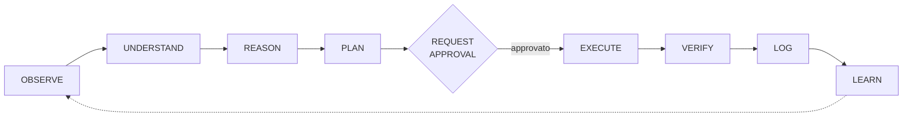
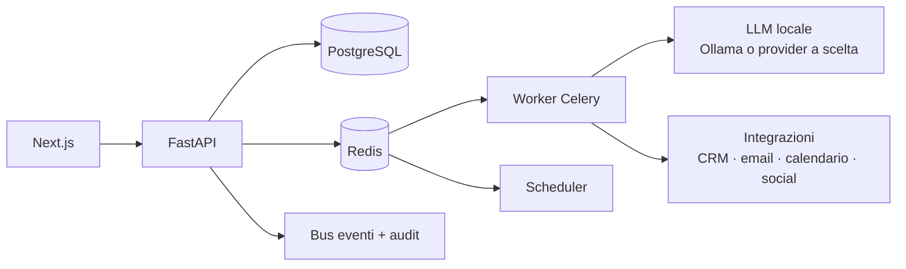

# AI Business OS 🧠

> Piattaforma operativa **AI local-first** per piccole e medie imprese: collega CRM, email, calendario, pipeline di vendita e social, interpreta i dati, **propone decisioni ed esegue azioni chiedendo l'approvazione umana** quando serve.

[](LICENSE)


**Stato:** in sviluppo — milestone M1–M3 di 16 completate · **Autore:** Gaspare Pettinati

---

## L'idea
Non è un chatbot. Il sistema lavora secondo un ciclo esplicito e verificabile:



Ogni azione che tocca clienti, soldi o dati passa da una **richiesta di approvazione** e lascia una traccia di audit.

## Stato del progetto
| Milestone | Contenuto | Stato |
|---|---|---|
| M1 — Infrastruttura | struttura del repo, backend FastAPI e frontend Next.js che comunicano | ✅ |
| M2 — Database | schema PostgreSQL con migrazioni Alembic e dati demo | ✅ |
| M3 — Auth + RBAC | login JWT con refresh rotante, reset password, permessi `risorsa.azione`, isolamento tra tenant | ✅ |
| M4 → M16 | CRM, agenti, integrazioni, workflow, osservabilità… | 🔜 vedi [ROADMAP.md](ROADMAP.md) |

Tutto ciò che è segnato come completato è **testato contro un database PostgreSQL reale**: nessuna integrazione simulata spacciata per reale.

## Principi architetturali
Local First · Privacy First · Security First · API First · AI Provider Agnostic · Event Driven · Auditable · Multi Tenant · Human In The Loop · Fail Safe · Observable · Modular

## Architettura (obiettivo)



## Stack
| Livello | Tecnologie |
|---|---|
| Backend | Python 3.11+, FastAPI, Pydantic v2, SQLAlchemy 2, Alembic |
| Database e code | PostgreSQL, Redis, Celery |
| Frontend | Next.js, React, TypeScript, Tailwind CSS |
| AI | indipendente dal provider, LLM locale come predefinito |
| Infrastruttura | Docker Compose (frontend, backend, postgres, redis, worker, scheduler, ollama, reverse proxy) |
| Qualità | pytest (unit, integrazione, sicurezza), ruff, mypy |

## Avvio

### Con Docker

```bash
git clone https://github.com/gahash/ai-business-os.git
cd ai-business-os
cp .env.example .env               # genera JWT_SECRET, APP_SECRET, ENCRYPTION_KEY (vedi sotto)
docker compose up -d
docker compose exec backend alembic upgrade head
```

- API: http://localhost:8000/health
- Frontend: http://localhost:3000
- Reverse proxy: http://localhost

### Senza Docker
Il database di sviluppo usa PostgreSQL nativo tramite `pgserver`: nessun installer né servizio di sistema.

```bash
py -3.11 -m venv .venv
.venv/Scripts/python -m pip install -e ".[dev]"

.venv/Scripts/python -m scripts.dev_postgres start
.venv/Scripts/python -m alembic upgrade head
.venv/Scripts/python -m scripts.seed

.venv/Scripts/python -m uvicorn apps.api.main:app --reload --port 8000
```

Frontend, in un altro terminale:

```bash
cd apps/web
npm install
npm run dev                          # http://localhost:3000
```

### Login sul tenant demo
Il comando `scripts.seed` crea un tenant `demo` con credenziali **solo dimostrative**:

```bash
curl -X POST http://localhost:8000/api/v1/auth/login \
  -H "Content-Type: application/json" \
  -d '{"tenant_slug":"demo","email":"owner@demo.local","password":"ChangeMe123!"}'
```

### Segreti
`JWT_SECRET`, `APP_SECRET` ed `ENCRYPTION_KEY` vanno generati, non lasciati vuoti:

```bash
python -c "import secrets; print(secrets.token_urlsafe(48))"
```

## Test

```bash
.venv/Scripts/python -m pytest
```

## Documenti
- [ROADMAP.md](ROADMAP.md) — milestone M1…M16 e regole di sviluppo
- [TODO.md](TODO.md) — lavoro tecnico in corso e limitazioni note
- [CHANGELOG.md](CHANGELOG.md) — modifiche rilasciate

Regole del progetto: niente pseudo-codice, niente funzioni vuote, niente integrazioni simulate presentate come reali, niente funzionalità "fatta" senza test e senza superare la sua Definition of Done.

---

**Licenza:** [MIT](LICENSE) · **Contatti:** [gasparepettinati.it](https://gasparepettinati.it) · info@gasparepettinati.it
